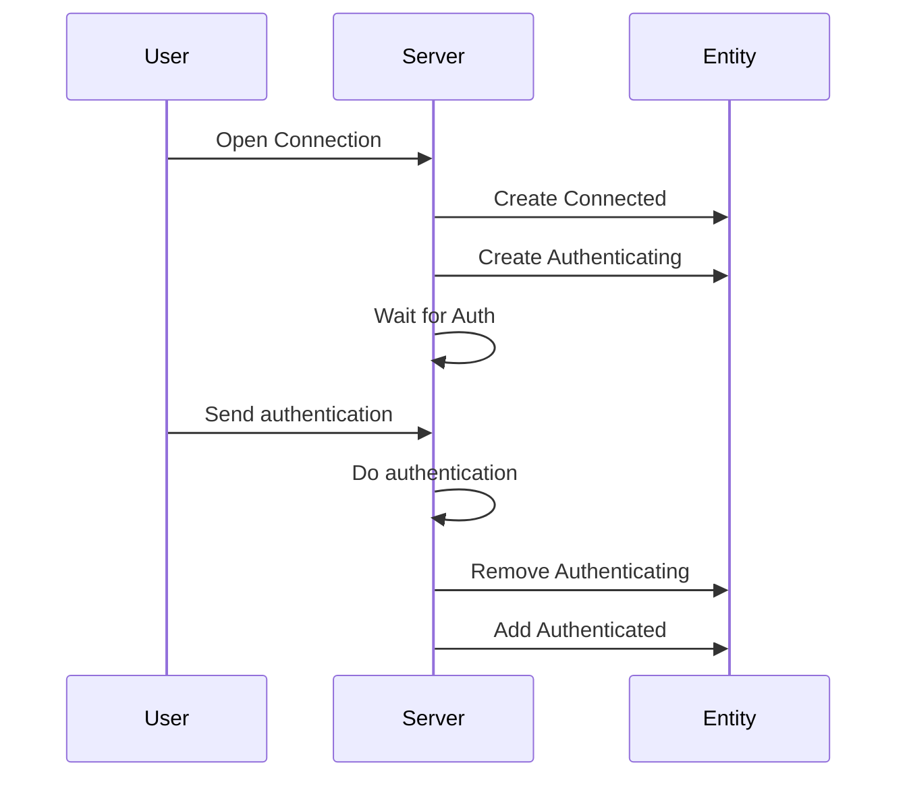

# Connecting

Alice->>Bob: Hello Bob, how are you ?
Bob->>Alice: Fine, thank you. And you?
create participant Carl
Alice->>Carl: Hi Carl!
create actor D as Donald
Carl->>D: Hi!
destroy Carl
Alice-xCarl: We are too many
destroy Bob
Bob->>Alice: I agree
